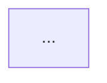

## When to Use This Skill

- HLD / TECH_DESIGN / LLD-* / ARCHITECTURE.md / DECISIONS.md change
- New service, connector, or data pipeline ships
- New domain model or shared type added (`shared/types/`, `shared/services/`)
- User asks "update tech guide" / "document architecture for X"
- Pipeline stage 8.5 when diff touches `shared/`, `server/services/`, `server/config/`, `mcp/shared/`

## Quick Start

```
Input: { techArea, releaseName, changeSummary }
Output: docs/technical/<doc>.md (HLD.md, LLD-<area>.md, TECH_DESIGN.md) or ARCHITECTURE.md / DECISIONS.md patch

Procedure:
1. Inventory tech delta from diff (services, connectors, data flows, ADRs, config keys)
2. For each: purpose, diagram (mermaid or ASCII), contracts, invariants, rollback
3. Sections per documentation-consistency.mdc
4. Cite source file + line for every claim
```

## Output Template

```markdown
---
product: Portfolio Delivery Ops
lastUpdated: 2026-11-19
coversVersion: "3.0"
area: release-dataset
---

# Technical Guide — <Area>

## Overview
...

## Architecture Diagram


## Service Contracts
| Service | Input | Output | Source |
|---------|-------|--------|--------|
| ... | ... | ... | [file.ts:42] |

## Data Model
...

## Invariants & Rollback
...
```

## Document Map

| Document | When to update | Audience |
|----------|---------------|----------|
| `ARCHITECTURE.md` | Layer or connector change | architect, team_mgr |
| `DECISIONS.md` | New ADR (D-number) | architect, portfolio_mgr |
| `docs/technical/HLD.md` | System-level design change | architect |
| `docs/technical/LLD-<area>.md` | Service/domain detail change | architect, team_mgr |
| `docs/technical/TECH_DESIGN.md` | Implementation design (Phase plan) | team_mgr, ic |
| `docs/technical/ARCHITECTURE_TARGET.md` | Future-state architecture | architect |

## KPI contract

- `KPI: every service/connector change in diff has a tech-doc section` — MISS if missing
- `KPI: diagram present for new data flow` — MISS if absent
- `KPI: all claims cited with file:line` — MISS if uncited

## Delegation

Owner: `doc-specialist`. Triggered by `ops-assistant` or pipeline stage 8.5.
