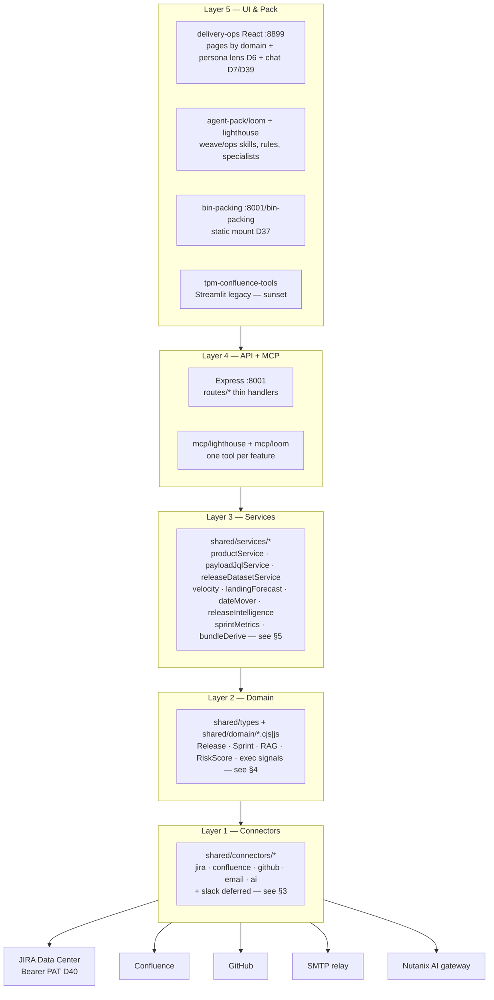

# Developer Guide — Portfolio Delivery Ops

> **audience:** `ic` · `team_lead` · `architect` — anyone who builds, reviews, or operates this monorepo.<br>
> **Prerequisites:** Node ≥ 20, JIRA Data Center PAT, familiarity with React 18 + Express. No NDB-specific knowledge required — the platform is product-agnostic ([D1](../../DECISIONS.md#d1--platform-is-product-agnostic)).<br>
> **Docs pipeline:** this file is Markdown → HTML via `node scripts/docs-build.js` (header/breadcrumb wrapper) and verified by `bash scripts/docs-verify.sh`. Both are part of the weave link-integrity gate.

For end-user usage see [USER_GUIDE.md](USER_GUIDE.md). For architecture decisions see [ARCHITECTURE.md](../../ARCHITECTURE.md) and [DECISIONS.md](../../DECISIONS.md). For the full feature inventory see [FEATURE_CATALOG.md](../architecture/FEATURE_CATALOG.md).

---

## Contents

- [0 — TL;DR: Run in 5 Minutes](#0--tldr-run-in-5-minutes)
- [1 — Where Things Live](#1--where-things-live)
- [2 — Architecture at a Glance](#2--architecture-at-a-glance)
- [3 — Layer 1: Connectors](#3--layer-1-connectors)
- [4 — Layer 2: Domain Models & Shared Types](#4--layer-2-domain-models--shared-types)
- [5 — Layer 3: Services](#5--layer-3-services)
- [6 — Layer 4: API + MCP](#6--layer-4-api--mcp)
- [7 — Layer 5: UI & Pack](#7--layer-5-ui--pack)
- [8 — Common Tasks](#8--common-tasks)
- [9 — Config & Env Reference](#9--config--env-reference)
- [10 — Troubleshooting](#10--troubleshooting)
- [Appendix A — Rules Index](#appendix-a--rules-index)
- [Appendix B — Glossary & Decision Map](#appendix-b--glossary--decision-map)

---

## 0 — TL;DR: Run in 5 Minutes

**Fixed ports — no fallback** ([AGENTS.md](../../AGENTS.md#project-defaults)): React **8899**, Express **8001**. `8899 → 8001` proxy is `apps/delivery-ops/client/src/setupProxy.js` (dev-only). Do not reintroduce `8888` or auto-detect.

```bash
# 1. Install (from repo root)
npm install

# 2. Configure server env (copy and fill secrets — never commit)
cp apps/delivery-ops/server/.env.example apps/delivery-ops/server/.env
# Required: JIRA_PAT (or JIRA_TOKEN) — Data Center PAT, sent as Authorization: Bearer
# Recommended: JIRA_BASE_URL (default https://jira.nutanix.com)

# 3. Run delivery-ops
npm run delivery-ops:dev          # from repo root (runs server + client via concurrently)
# — or — if you have the helper:
# cd apps/delivery-ops && ./restart

# 4. Open
# React app:  same origin as server in prod; in dev use the React dev server port 8899
# Express:    port 8001 — serves /api/* and docs at /docs/*
# Docs hub:   /docs/  (served from docs/ via server/index.js docsRoot)
```

Verify:

```bash
# Docs hub and guides render
node scripts/docs-build.js && bash scripts/docs-verify.sh
# No hardcoded localhost in shipped code
npm run check:no-localhost && npm run check:product-agnostic && npm run check:mcp
# Shared build
npm --workspace @portfolio-delivery-ops/shared run build 2>/dev/null || echo "shared: no build step — consumed as source"
# MCP builds
npm run mcp:build
```

**What you get:** the full delivery-ops React app (release versions, sprint reports, KPIs, exec dashboards, chatbot, email sender), the docs hub at `/docs/`, and the MCP surfaces if your host is wired (see §6). Bin-packing is served at `/bin-packing/` (new tab).

---

## 1 — Where Things Live

Monorepo root is `~/NDB-Ops-Tools/ndb-delivery-ops/` (future `portfolio-delivery-ops` per [D2](../../DECISIONS.md#d2--rename-to-portfolio-delivery-ops)). The legacy name `ndb-status-update-sender` no longer exists as a directory — any doc still referencing it is stale.

```
ndb-delivery-ops/
├── AGENTS.md                          # project persona — read second after ~/.cursor/AGENTS.md
├── ARCHITECTURE.md                    # 5-layer model (this guide's source of truth)
├── DECISIONS.md                       # D1…D43 locked decisions (cite by ID)
├── README.md                          # workspace quick-start + repo lineage
├── docs/
│   ├── index.html                     # hub — generated + checked by docs-verify
│   ├── README.md                      # docs SoT note
│   ├── guides/                        # Markdown → HTML via scripts/docs-build.js (this file lives here)
│   ├── api/                           # per-resource API contracts (one file per route group)
│   ├── pages/                         # per-page requirements + data-layer specs
│   ├── architecture/                  # FEATURE_CATALOG.md, CONSOLIDATION.md
│   └── handover/ technical/ product/  # PRD, HLD, exec pitch
├── apps/
│   ├── delivery-ops/                  # THE single user runtime (React 8899 + Express 8001)
│   │   ├── client/                    # React 18 — see §7 for src/ layout
│   │   │   ├── src/
│   │   │   │   ├── components/        # page-level + shared UI (render only)
│   │   │   │   ├── hooks/             # data fetching (one hook per data need)
│   │   │   │   ├── services/          # API wrappers (one fn per endpoint group)
│   │   │   │   ├── contexts/          # TeamContext, SelectedReleaseContext, ReleaseDataContext
│   │   │   │   ├── layout/            # Sidebar (persona-aware D6), Header
│   │   │   │   ├── auth/              # JIRA PAT auth, role detection
│   │   │   │   ├── release/           # ReleaseBriefPage, RetrospectivePage, ChatbotPage
│   │   │   │   ├── feature/           # FeatureDashboardPage
│   │   │   │   ├── design-system/     # DesignSystemDemo
│   │   │   │   ├── shared/            # apiService.js (canonical; utils/api.js re-exports)
│   │   │   │   └── setupProxy.js      # dev proxy: /docs → 8001
│   │   │   └── package.json           # PORT=8899, proxy, react-scripts
│   │   ├── server/                    # Express — see §6 for routes/
│   │   │   ├── index.js               # entry: middleware, route mounting, docsRoot, PORT 8001
│   │   │   ├── routes/                # thin handlers — validate → call service → respond
│   │   │   ├── services/              # business logic per domain (mirrors shared/services)
│   │   │   ├── middleware/            # security, validation, auth/jira
│   │   │   ├── utils/                 # jiraClient.js (CJS adapter → shared JiraConnector), formatters
│   │   │   ├── config/                # JSON configs — see §9
│   │   │   └── .env / .env.example    # secrets + env overrides — never commit .env
│   │   ├── bin-packing -> ../bin-packing  # symlink for server static mount
│   │   ├── package.json               # dev = concurrently server + client
│   │   └── restart                    # one-shot dev launcher
│   ├── bin-packing/                   # vanilla JS static app — served at /bin-packing/* (D37)
│   └── tpm-confluence-tools/          # Python/Streamlit legacy — sunset pending Phase F
├── shared/                            # cross-runtime TypeScript (ESM) — see §3-5
│   ├── src/
│   │   ├── connectors/                # jiraConnector, confluenceConnector, githubConnector, emailConnector, aiConnector
│   │   ├── domain/                    # D41 derives: execSummarySignals.cjs, bundleDerive.js, etc.
│   │   ├── services/                  # productService, payloadJqlService, releaseDatasetService, …
│   │   ├── agentPack/                 # loadAgentPack() — D38 portable pack loader
│   │   ├── agentRuntime/              # runAgentTurn() — D39/D42 chat runtime
│   │   ├── types/                     # Release, Ticket, Persona, RAG, AudienceId, ProductConfig
│   │   └── utils/                     # date, JQL builders, ID maps
│   └── package.json                   # @portfolio-delivery-ops/shared
├── mcp/                               # MCP surfaces (stdio) — see §6
│   ├── shared/                        # deduplicated env + glossary
│   ├── lighthouse/                    # product tools only (bin: lighthouse-mcp)
│   └── loom/                          # builder tools only (bin: loom-mcp)
├── agent-pack/                        # portable cookbook — SoT for every host (D38)
│   ├── loom/                          # Loom weaver pack (this guide's loom)
│   │   ├── identity/                  # loom.md (orchestrator) + specialists/{frontend,backend,connector}-dev.md
│   │   ├── skills/                    # weave, review, exec, csv-import, deploy
│   │   ├── rules/                     # weave.mdc, no-localhost.mdc, minimal-architecture.mdc, …
│   │   ├── connectors/                # loomAuth.ts
│   │   ├── context/                   # architecture.md
│   │   ├── prompts/                   # builder.md
│   │   ├── memory/                    # schema.json
│   │   └── manifest.json              # identities, rules, skills, toolClasses
│   └── lighthouse/                    # product pack (ops-assistant + team-exec/tpm/rm specialists)
├── scripts/
│   ├── docs-build.js                  # Markdown → HTML wrapper (site header/breadcrumb)
│   ├── docs-verify.sh                 # hub exists + required guides + stale refs + link check
│   ├── check-no-localhost.js          # no hardcoded localhost in app code
│   └── check-product-agnostic.js      # no hardcoded product strings
└── package.json                       # root workspaces + delivery-ops:dev + mcp:build
```

**Key symlinks / adapters:**

| Host path | Points to | Purpose |
|---|---|---|
| `.cursor/skills` → `agent-pack/...` | pack skills | Cursor discovery — never fork a second copy |
| `.cursor/rules` | pack rules + builder-only rules | Cursor enforcement |
| `.cursor/agents` → `agent-pack/identity` | pack identities | orchestrator + specialists |
| `apps/delivery-ops/client/src/utils/api.js` | `shared/services/apiService.js` | backward-compat re-export (canonical is `shared/services/apiService.js`) |

---

## 2 — Architecture at a Glance

**One feature, one place.** Each capability has a single canonical implementation in `shared/`; every surface (React page, Express route, MCP tool, agent skill) imports it. See [ARCHITECTURE.md](../../ARCHITECTURE.md) for the full five-layer model.



**Guiding principles (from [ARCHITECTURE.md](../../ARCHITECTURE.md)):**

1. Product-agnostic by design ([D1](../../DECISIONS.md#d1--platform-is-product-agnostic)) — NDB is one tenant; DataLens/NCM/future products are equally valid. Every NDB string is config-driven via `teamBoardConfig.json` + `productService`.
2. Connectors are sacred ([D3](../../DECISIONS.md#d3--five-connectors-are-first-class)) — no ad-hoc `axios.get(JIRA_URL)` outside a connector.
3. Services own business logic — routes and pages are thin.
4. One runtime for users — single React app on `8899` (`client/package.json` `PORT=8899`) + `8001` (`server/.env` `PORT=8001`, `server/index.js` default `8001`).
5. Personas drive presentation, not access ([D6](../../DECISIONS.md#d6--tab-visibility-default-landing-and-role-lens-revised-2026-05-19)) — role lens re-renders the same data.
6. AI is a surface, not a separate product — MCP + skills + `agentRuntime` are the AI surface of the same features.
7. Workflows for recurring artefacts, agents for ad-hoc questions.

---

## 3 — Layer 1: Connectors

Lives in `shared/src/connectors/`. One TypeScript module per external system. Each owns auth, retries, error wrapping, and returns typed responses. No business logic — pure adapter.

| Connector | File | Auth | Purpose |
|---|---|---|---|
| `jiraConnector` | `shared/src/connectors/jiraConnector.ts` | **Data Center PAT `Authorization: Bearer` only** ([D40](../../DECISIONS.md#d40--one-jira-connector-data-center-pat-bearer-only)) — not Cloud Basic/OAuth | All JIRA Data Center REST v2 + Agile calls: search, issue fetch, versions, sprints, boards. Exponential backoff on 429. Express reaches it via `apps/delivery-ops/server/utils/jiraClient.js` (`getJira`, `searchPages`); MCP constructs `JiraConnector` directly. |
| `confluenceConnector` | `shared/src/connectors/confluenceConnector.ts` | PAT (may reuse `JIRA_PAT` if SSO) | All Confluence REST calls + `appendStructuredRow` primitive (used by Date Mover audit) |
| `githubConnector` | `shared/src/connectors/githubConnector.ts` | `GITHUB_TOKEN` Bearer | Commits / PRs / repos / CI signals |
| `emailConnector` | `shared/src/connectors/emailConnector.ts` | SMTP `SMTP_HOST/PORT/USER/PASS` | Send digests; SMTP transport only — templates stay in `server/services/emailService.js` |
| `aiConnector` | `shared/src/connectors/aiConnector.ts` | `AI_API_KEY` (NuToken) | LLM transport only (`chatCompletion`/`completeChat`) — no domain prompts; delegates from `naiService` |
| `slackConnector` | *not yet* | — | Deferred — no caller yet; do not add until needed ([D3](../../DECISIONS.md#d3--five-connectors-are-first-class)) |
| `loomAuth` | `agent-pack/loom/connectors/loomAuth.ts` | env-derived | Loom-specific auth provider for weave |

**Env loader:** `shared/src/connectors/env.ts` — `loadEnv({ requirePat })`. `requirePat: true` (default) throws if no `JIRA_PAT`/`JIRA_TOKEN` in env — for batch/MCP. HTTP routes pass `requirePat: false` and override per-request from `Authorization: Bearer <pat>` header.

**JIRA field IDs:** never inline `customfield_NNNNN`. Server resolves via `productService` → `teamBoardConfig.json` (+ per-product overrides); client imports constants from `apps/delivery-ops/client/src/utils/jiraFields.js` (mirror of server's `jiraFieldsConfig.json`). See also [minimal-architecture.mdc](../../agent-pack/loom/rules/minimal-architecture.mdc).

---

## 4 — Layer 2: Domain Models & Shared Types

| Location | What | Notes |
|---|---|---|
| `shared/src/types/` | `Release`, `Sprint`, `Ticket`, `Persona`, `RAG`, `RiskScore`, `AudienceId`, `ProductConfig`, `ProductRegistry` | Pure TS types + small helpers, no IO. Both services and React import from here. |
| `shared/src/domain/` | Browser-safe derives lifted per [D41](../../DECISIONS.md#d41--domain-derives-live-in-shared-not-in-pages-or-fat-routes) | CJS for Express `require()` (`.cjs`) + ESM for browser (`.js`). Not compiled — `shared/package.json` `exports` point at source; `tsconfig.json` excludes `src/domain`. |
| `shared/src/domain/README.md` | Conventions for adding a domain module | Pick CJS if Express needs `require()`, ESM if CRA needs it; register in `shared/package.json` `exports` |

**Domain derives ([D41](../../DECISIONS.md#d41--domain-derives-live-in-shared-not-in-pages-or-fat-routes)):**

| Capability | Shared home | App leftover |
|---|---|---|
| Exec-summary signals (`deriveSignals`) | `shared/src/domain/execSummarySignals.cjs` | CJS shim in `server/utils/execSummarySignals.js` |
| Exec-summary analytics | `shared/src/domain/execSummaryAnalytics.cjs` | Route injects `gateDates` + `formatDate` |
| Release intelligence buckets | `shared/src/services/releaseIntelligence.ts` | App service keeps JIRA fetch + existing JQL |
| Sprint health rates | `shared/src/services/sprintMetrics.ts` (+ `.cjs`) | `sprintService` keeps live JIRA I/O |
| Bundle-first page derives | `shared/src/domain/bundleDerive.js` | CRA adapter at `client/src/release/utils/bundleUtils.js` (CRA cannot import `@portfolio-delivery-ops/shared` without pulling Node connectors — smoke-checked) |

**Product-agnostic types:** `ProductConfig` carries `projectKey`, `labelPrefix`, `releasePrefix`, `sprintCalendar`, audience overrides, Confluence space. Defaults per [D34](../../DECISIONS.md#d34--productservice-is-the-only-source-of-projectkey-labelprefix-releaseprefix-sprintcalendar): `labelPrefix` → `product.id`; `releasePrefix` → `${product.name}-`; `sprintCalendar` has **no default — throws**.

---

## 5 — Layer 3: Services

Lives in `shared/src/services/` and `apps/delivery-ops/server/services/`. Stateless — every call self-contained. Each calls connectors (L1) and uses domain models (L2). Reusable from Express routes (L4) and MCP tools (L4).

Status: ● shipped · ◐ partial · ○ planned (see [CONSOLIDATION.md](../architecture/CONSOLIDATION.md) for per-capability tracker).

| Service | Status | Owns | Used by |
|---|---|---|---|
| `productService` ([D1](../../DECISIONS.md#d1--platform-is-product-agnostic), [D34](../../DECISIONS.md#d34--productservice-is-the-only-source-of-projectkey-labelprefix-releaseprefix-sprintcalendar)) | ● | Resolve `productId` → `projectKey`, `labelPrefix`, `releasePrefix`, `sprintCalendar`, audience overrides. Reads `teamBoardConfig.json`. **Only source** for these D1 inputs. Multi-team registry per [D43](../../DECISIONS.md#d43--multi-team-registry-after-the-app-stabilized) — NDB is default `defaultTeamId`. | every service that touches external systems |
| `payloadJqlService` ([D36](../../DECISIONS.md#d36--payload-splits-into-engineering-payload-and-release-payload)) | ● | **6-bucket release JQL union** (incl. Bucket 1B `epics_of_projects`). `buildEngineeringPayloadJql` (project-scoped, legacy) vs `buildReleasePayloadJql` (cross-project — **default** for [D36](../../DECISIONS.md#d36--payload-splits-into-engineering-payload-and-release-payload)). Group 2 `getMovedOutQuery`, Group 3 `getLongTerm*Query`. See Payload concepts below. | `releaseDatasetService`, group 2/3 analytics, clickable JQL links |
| `ticketFetchService` | ● | 8-clause cross-project FEAT-walk JQL; `projectKey` scoping optional; JIRA URL builder | `/api/jira/issue-breakdown` (live), `TaskBreakdownCell` |
| `releaseDatasetService` (trunk + cache + sync, Phase 3) | ◐ | `fetchReleaseData` fetches 3 groups / 6 Group-1 buckets in parallel, dedup within release; `processMaster` adds derived columns. **Defaults to Release Payload** (no project filter — ERA + FEAT + TECHPUBS + all contributors). Pass `projectKey` to `fetchBucket` for Engineering Payload (legacy EM/IC views). `ProcessedTicket` = 56 columns. | analytics consumers, `SyncHubPage`, `GET /api/release-dataset/*` |
| `velocityService` (#2) | ● | 3-stream velocity (Dev / QA-Verif ×0.33 / QA-Test) from cached tickets; `searchCount` fallback | `GET /api/release-dataset/velocity`, Release Brief |
| `landingForecastService` (#4) | ● | MVP landing date (`fallback_running`) from trunk outstanding + trailing velocity; `assembleLandingForecast` shared | `GET /api/release-dataset/forecast`, `LandingForecastPanel` |
| `dateMoverService` ([D30](../../DECISIONS.md#d30--date-mover-requires-a-reason-audited-to-confluence)) | ● | Move gate date (JIRA FEAT + Confluence audit + rollback, or release-config slip) **with mandatory reason**. RM/TPM + Portfolio Manager may execute per [D26](../../DECISIONS.md#d26--action-level-authorization). | `POST /api/date-mover/move-gate-date`, `move_jira_dates` MCP adapter (same Confluence audit) |
| `releaseInsightsService` | ◐ | `computePayloadMetrics` (planned_total / completion_pct / group shares) + `computeLabelAnchoredMetrics`. First slice shipped; remaining: flow/triage/cohort/cycle-time/pace/`computeReleaseMatrix`/`computeTeamMatrix` | future dashboards, `team-exec` reports |
| `releaseClassificationService` | ● | Parse/classify release names (`NDB-2.11` → Major/Minor/Patch/Pre-release). D1 via `productPrefix`. | dataset assembly |
| `sprintsService` | ● | Enumerate sprints over fixed-cadence calendar. D1 via `SprintCalendar` (NDB = `2024-10-23 + 21d`). | dataset assembly, sprint dashboards |
| `sprintMetrics` ([D41](../../DECISIONS.md#d41--domain-derives-live-in-shared-not-in-pages-or-fat-routes)) | ● | `getSprintMetrics` — completion / pending-QA / carryover / scope-creep rates | `sprintService`, Sprint Report |
| `execSummarySignals` ([D41](../../DECISIONS.md#d41--domain-derives-live-in-shared-not-in-pages-or-fat-routes)) | ● | `deriveSignals` + `PHASE_RELEVANCE` | `POST /api/ai/exec-summary`, release briefing |
| `bundleDerive` ([D41](../../DECISIONS.md#d41--domain-derives-live-in-shared-not-in-pages-or-fat-routes)) | ● | Bundle-first page derives (retro, brief, component, past-sprint) | Retrospective, Release Brief, Component Report |
| `riskIndicator` | ● | `classifyRiskIndicator`, `computeReleaseHealthVerdict`, `countSelfReportedRisk`, `bucketCounts` | briefing, chat snapshot, `get_release_status` |
| `releaseIntelligence` ([D41](../../DECISIONS.md#d41--domain-derives-live-in-shared-not-in-pages-or-fat-routes)) | ● | `classifyFeature`, `buildFeatureRecord`, `assembleReleaseIntelligence` | `releaseAiSummaryService`, chat snapshot |
| `agentPack` (`loadAgentPack`, [D38](../../DECISIONS.md#d38--agent-pack-is-portable-cursor-is-one-adapter)) | ● | Load portable identity/skills/workflows/rules from `agent-pack/`. Host-agnostic. | web chat, Cursor adapter, future hosts |
| `agentRuntime` (`runAgentTurn`, [D39](../../DECISIONS.md#d39--web-chat-is-an-agent-runtime-not-a-mailbox)/[D42](../../DECISIONS.md#d42--open-the-door-safely-memory-provenance-hitl-wave-4)) | ● | Perceive→plan→act loop + session/user/org memory, provenance, HITL pause for `mutate`. [D26](../../DECISIONS.md#d26--action-level-authorization) gate still records `blocked_d26` until coded. | `POST /api/ai/chat`, `GET/POST /api/ai/approvals` |

**Payload concepts — Engineering vs Release ([D36](../../DECISIONS.md#d36--payload-splits-into-engineering-payload-and-release-payload)):** NDB is a portfolio — ERA (engineering), FEAT (intake), TECHPUBS (docs), PM, SDL, LEG etc. all set `fixVersion = NDB-2.11` on their tickets. Two payloads exist:

| Concept | JQL shape | Audience | Default in |
|---|---|---|---|
| **Engineering Payload** | `project = ERA AND (6-bucket union)` | EM, IC, sprint burndown | legacy chatbot; `buildEngineeringPayloadJql`; `fetchBucket({ projectKey })` |
| **Release Payload** | `(6-bucket union)` — **no project filter** | TPM, RM, Team Exec — "are we shipping?" | `buildReleasePayloadJql`; `fetchReleaseData` default (since 2026-06-13). No pollution guard — trust `fixVersion`. |
| **Group 2 — Moved Out** | `fixVersion was {release} AND fixVersion not in ({release})` | hygiene analysis | `getMovedOutQuery` — every sync |
| **Group 3 — Long-term Funded** | `issuetype in (Feature, Initiative) AND fixVersion in ({futureReleases})` + epics + work | capacity planning | `getLongTerm*Query` — `futureReleases` from versions API at sync time |

**Remaining ports:** tracked in [CONSOLIDATION.md](../architecture/CONSOLIDATION.md) — chart catalog, team-exec report service, capacity, Confluence template engine, say-vs-do, story points, etc. Prioritise via DECISIONS.md pending decisions (D28/D29).

---

## 6 — Layer 4: API + MCP

Two parallel surfaces over the same services. **Routes are thin: validate → call service → respond.** No JQL building, no HTML generation inline.

### Express routes — `apps/delivery-ops/server/routes/`

| Route file | Prefix | What it serves |
|---|---|---|
| `jira/` (`index`, `auth`, `fetch`, `search`, `kpi`, `releaseVersions`) | `/api/jira/*` | validate, fetch, search-by-JQL, release versions, sprint-report, KPIs |
| `releaseDataset.js`, `releaseSync.js` | `/api/release-dataset/*`, `/api/release-sync/*` | dataset fetch + cache-first sync (Group 1–3) |
| `releaseOutstandingWork.js` | `/api/release-outstanding-work/*` | outstanding-work page (JIRA-backed) |
| `dateMover.js` | `/api/date-mover/*` | gate-date move (D30 — mandatory reason + Confluence audit) |
| `dependency.js` | `/api/dependency/*` | dep graph (JIRA `blocks`/`is blocked by` canonical D18) |
| `feature.js`, `component.js` | `/api/feature/*`, `/api/component/*` | Feature Dashboard, Component Report |
| `email/` | `/api/email/*`, `/api/team/*/status-email` | send, preview, history, scheduled |
| `ai.js` | `/api/ai/chat`, `/api/ai/approvals`, `/api/ai/exec-summary` | `agentRuntime` (D39/D42) + exec-summary signals |
| `admin.js`, `config.js`, `statusSnapshots.js`, … | `/api/admin/*`, `/api/config/*` | admin, team registry, status snapshots |
| `index.js` mounting | `/*` static + `/docs` + `/bin-packing` | `docsRoot` serves `docs/` at `/docs/`; bin-packing mount per D37 |

**Docs + proxy:** `server/index.js` mounts `docs/` at `/docs/` and `/Documentation` (both proxied in dev via `client/src/setupProxy.js` → `http://localhost:8001`). Pages should link with **relative** `/docs/guides/DEVELOPER_GUIDE.html` — never `http://localhost:8001` (violates [no-localhost.mdc](../../agent-pack/loom/rules/no-localhost.mdc)).

**Auth:** `Authorization: Bearer <jiraPat>` (Data Center PAT) — all JIRA proxy routes. Username from header `X-Username`/`X-User-Email` or token validation (`/rest/api/2/myself`). Role checks are action-level per [D26](../../DECISIONS.md#d26--action-level-authorization), not tab visibility.

### MCP servers — `mcp/`

| Package | Bin | What |
|---|---|---|
| `mcp/shared` | — | deduplicated env + glossary (single source) |
| `mcp/lighthouse` | `lighthouse-mcp` | product tools only — `get_release_status`, `say_vs_do`, `plan_capacity`, `bin_pack_projects`, etc. |
| `mcp/loom` | `loom-mcp` | builder tools only — `move_jira_dates` (thin adapter over `DateMoverService` D30), weave helpers |

Each MCP tool calls the same `shared/connectors` + `shared/services` the Express route does. JIRA auth is Data Center PAT `Authorization: Bearer` only ([D40](../../DECISIONS.md#d40--one-jira-connector-data-center-pat-bearer-only)). Legacy MCP private JIRA client is deleted.

**Registering:** `.cursor/mcp.json` registers the servers for Cursor automatically. For Claude Desktop, see [README.md](../../README.md#wiring-the-mcp-server-into-cursor).

---

## 7 — Layer 5: UI & Pack

### React app — `apps/delivery-ops/client/src/` (port **8899**)

```
src/
├── App.js                     # BrowserRouter, AuthProvider + TeamProvider + SelectedReleaseContext, protected routes
├── layout/components/Layout.js # Sidebar (persona-aware D6) + Header + role lens dropdown
├── auth/                      # AuthContext, LoginForm (JIRA PAT validation), ProtectedRoute, permissions
├── contexts/                  # TeamContext, SelectedReleaseContext, ReleaseDataContext
├── components/                # page-level UI (render only — no direct axios/fetch)
├── hooks/                     # data fetching — one hook per need (useTeams, useReleaseItems, useChat, …)
├── services/                  # per-endpoint API wrappers (jiraQueryService, confluenceService, …)
├── shared/services/apiService.js # canonical authenticatedPost/Get (utils/api.js re-exports)
├── release/                   # ReleaseBriefPage, RetrospectivePage, ChatbotPage, utils/bundleUtils.js
├── feature/                   # FeatureDashboardPage
├── jira/                      # JQL digging, issue breakdown
├── utils/                     # api helpers, jiraFields.js (field constants), requestGate
├── design-system/             # DesignSystemDemo
└── setupProxy.js              # dev proxy: /docs → 8001 (only place that mentions localhost)
```

**Layer rule ([minimal-architecture.mdc](../../agent-pack/loom/rules/minimal-architecture.mdc)):** components render, hooks fetch, services transform. If you delete the JSX from a component file, no network call should vanish. See file-size limits in [Appendix A](#appendix-a--rules-index).

**Persona-aware sidebar ([D6](../../DECISIONS.md#d6--tab-visibility-default-landing-and-role-lens-revised-2026-05-19)):** every (non-admin) tab is visible to every user. Admin tabs gated by `admin` role only. Role lens dropdown in header re-renders current data in `team-exec`/`director)/`ic density — never hides data. Default landing per role (Team Exec → chat, TPM → Release Versions, RM → Sync Hub redirect → Project Status, EM → Team Profile) is a user-preference `defaultLandingPage`.

**Chat panel ([D7](../../DECISIONS.md#d7--agent-surface--web-chat-embedded-in-delivery-ops), [D39](../../DECISIONS.md#d39--web-chat-is-an-agent-runtime-not-a-mailbox), [D42](../../DECISIONS.md#d42--open-the-door-safely-memory-provenance-hitl-wave-4)):** `Release/ChatbotPage` → `POST /api/ai/chat` runs `shared/agentRuntime` (`runAgentTurn`): load pack (D38), perceive from release snapshot, tool-loop over `read`/`draft` (Wave 4 — `mutate` HITL-paused per D26, Approve records `blocked_d26` until gate coded). Memory is JSON files under `AGENT_RUNTIME_DIR` (default `.cache/agent-runtime`); provenance logs `{tools, dataScopes, replySha256, unknownKeysInReply, mode}` per turn.

**Pages fetch live ([D11](../../DECISIONS.md#d11--pages-fetch-live-sync-hub-is-not-a-product-surface)):** Project Status, Release Brief, SoS, chat grounding hit JIRA on load scoped to `team.baseFilter` (from `teamBoardConfig.json` via `productService`). No silent fallback to another team's cache. `/sync-hub` redirects to Project Status. Client in-memory TTL is 5 minutes; Refresh busts that TTL and re-hits live endpoints.

### Loom pack — `agent-pack/loom/` (portable cookbook, [D38](../../DECISIONS.md#d38--agent-pack-is-portable-cursor-is-one-adapter))

The **loom weaver** is one-shot: discuss scope → draft plan in `~/.opencode/plan/` → execute full pipeline via `agent-pack/loom/rules/weave.mdc` (Dev → Impact Scout → Review → QA → UX → PM → Exec → JIRA → Fix → Merge).

| Area | Files | Purpose |
|---|---|---|
| Orchestrator | `identity/loom.md` | "weaves features across 5 layers; discuss → plan → pipeline" — harness-agnostic (Opencode/Cursor/Claude/Codex via `agent-pack/harness/`) |
| Specialists | `identity/specialists/{frontend,backend,connector}-dev.md` | delegated sub-agents owned by orchestrator; users never address by name |
| Skills | `skills/weave/SKILL.md`, `review/SKILL.md`, `exec/SKILL.md`, `csv-import/SKILL.md`, `deploy/SKILL.md` | reusable capabilities — `weave` is the delivery pipeline, `review`/`exec` strengthen stages 2/6 |
| Rules | `rules/weave.mdc` (pipeline), `no-localhost`, `minimal-architecture`, `one-shot`, `api-docs-required`, `page-docs-required`, `no-hardcoding`, `gerrit-push-for-review` | constitutional rules — woven via `loadAgentPack()`; builder-only rules stay in `.cursor/rules/` |
| Context | `context/architecture.md` | 5-layer summary (fixed ports, one feature one place) |
| Prompt | `prompts/builder.md` | D1/D3/D38 builder prompt |
| Memory | `memory/schema.json` | shape for session/user/org memory (D42) |
| Manifest | `manifest.json` | version `3.0.0`, identities, rules, skills with `toolClass: read|draft|mutate` |

**Host adapters:** Cursor is one adapter — `.cursor/` symlinks into `agent-pack/`. Web chat loads pack via `shared/agentPack/loadAgentPack()`; any new host adds a file under `agent-pack/adapters/`, not a fork of skills. See `agent-pack/loom` + [DECISIONS.md D38](../../DECISIONS.md#d38--agent-pack-is-portable-cursor-is-one-adapter) for the cookbook contract.

### Static-mounted Bin-Packing — `apps/bin-packing/` ([D37](../../DECISIONS.md#d37--bin-packing-app-ships-as-a-static-mount-not-a-react-port))

Legacy 7k-LOC vanilla JS app (bin-packing algorithm with resource pools, 3-tier display) served as static assets by Express at `/bin-packing/*`. Sidebar entry opens **in a new tab** (`target="_blank"`) — the two UIs never share a viewport. In dev, URL computed via `getBinPackingUrl()` in `layout/components/Layout.js` (`${hostname}:${REACT_APP_BACKEND_PORT || 8001}/bin-packing/`); in prod, relative `/bin-packing/`. No auth on the mount (matches legacy port 3847). MCP tool `bin_pack_projects` is still a simpler First-Fit-Decreasing — not the real algorithm — until extraction to `shared/services/binPackingService.ts`.

### TPM Confluence Tools — `apps/tpm-confluence-tools/`

Python/Streamlit bulk page creator + template editor + Release Gates Checklist ([D20](../../DECISIONS.md#d20--tpm-confluence-pages-incl-data-driven-release-gates-checklist)). Served separately (`streamlit run app.py` in own venv). Features move into `apps/delivery-ops/client/src/domains/confluence/` in Phase F (Streamlit → React). Python Confluence client stays until then.

---

## 8 — Common Tasks

### Add a new page (thin composition over existing services)

1. **Read** [ARCHITECTURE.md](../../ARCHITECTURE.md) layers + [FEATURE_CATALOG.md](../architecture/FEATURE_CATALOG.md) to confirm the page is the right surface (vs MCP tool or skill).
2. **Service first:** if business logic doesn't exist, add it in `shared/src/services/<domain>Service.ts` (not in the route or component). Cover with tests. Respect `productService` for any `projectKey`/`labelPrefix` resolution — no hardcoded product strings.
3. **Route (thin):** `apps/delivery-ops/server/routes/<domain>.js` — validate → call service → respond. Keep under 80 lines (150 hard limit per [minimal-architecture.mdc](../../agent-pack/loom/rules/minimal-architecture.mdc)).
4. **Hook:** `apps/delivery-ops/client/src/hooks/use<Thing>.js` — fetching via `shared/services/apiService.js` (`authenticatedGet/Post`), no JSX.
5. **Component:** `apps/delivery-ops/client/src/components/<Page>.js` — render only, no `axios`/`fetch`. Compose from `shared/components/`. Cap at 300 lines (600 hard).
6. **Wire:** add route in `client/src/App.js`; nav entry in `layout/components/Layout.js` if non-admin (admin tabs gated — see [D6](../../DECISIONS.md#d6--tab-visibility-default-landing-and-role-lens-revised-2026-05-19)).
7. **Docs:** per `page-docs-required` rule — create `docs/pages/<Page>-requirements.md` + `docs/pages/<Page>-data-layer.md`. Update [docs/README.md](../README.md) if new doc area.
8. **Verify:** `node scripts/docs-build.js && bash scripts/docs-verify.sh` — link integrity gate before merge.

### Add a JIRA-backed endpoint

1. **Connector:** if new JIRA API, extend `shared/src/connectors/jiraConnector.ts` (Bearer PAT only — [D40](../../DECISIONS.md#d40--one-jira-connector-data-center-pat-bearer-only)). No ad-hoc axios in `server/routes/`.
2. **Service:** build JQL via `shared/src/services/payloadJqlService.ts` or `jqlBuilder.ts` — import builders, don't inline JQL. For release-scoped queries, use Release Payload (`buildReleasePayloadJql`) unless the consumer is EM/IC-only (then `buildEngineeringPayloadJql` with explicit `productId` via `productService`).
3. **Route:** thin wrapper per §6; inject `jiraPat` from `req.headers.authorization?.replace(/^Bearer\s+/i, '')` (cleaned via `server/utils/jiraClient.js`).
4. **Test:** exercise JQL live against `https://jira.nutanix.com` where QA pipeline requires it (counts must match `total` from connector).

### Author a Loom skill

1. **Where:** `agent-pack/loom/skills/<skill-name>/SKILL.md` — this is SoT; `.cursor/skills/` is a symlink for discovery.
2. **Required sections** (per `documentation-consistency.mdc`): `## When to Use This Skill` → `## Quick Start` → `## Core Rules` → `## Output Format` → `## Quality Validation` — in that order.
3. **Tool class:** declare in `agent-pack/loom/manifest.json` skills array (`read` = read-only, `draft` = auto-persist, `mutate` = HITL-queued per [D26](../../DECISIONS.md#d26--action-level-authorization)).
4. **Reuse:** reference the specialist that owns the skill (e.g. `tpm-specialist` for `weekly-status-email`). Orchestrator delegates; users never address specialist by name.
5. **Hosts discover** via `.cursor/skills`, `.claude/skills`, `.codex/skills`, `.agents/skills` symlinks (all into `agent-pack/loom/skills/`).

### Add a connector call

1. Extend the one connector file in `shared/src/connectors/<system>.ts` — no parallel client.
2. For JIRA fields, wire through `productService.getCustomFields(productId)` — never write `customfield_NNNNN` literal twice (client mirrors in `client/src/utils/jiraFields.js`).
3. For AI calls, go through `shared/src/connectors/aiConnector.ts` (`chatCompletion`), not direct gateway axios. Non-secret defaults (endpoint, model, timeout) live in `server/config/aiConfig.json`; secrets (`AI_API_KEY`) in env.

### Docs pipeline (every change that touches `docs/` or `client/src` links)

```bash
# 1. Edit markdown under docs/guides/, docs/api/, docs/pages/, etc.
# 2. Rebuild HTML wrappers
node scripts/docs-build.js
# 3. Verify hub + guides + stale refs + link check
bash scripts/docs-verify.sh
# — fails on missing docs/index.html, missing USER_GUIDE.md/ADMIN_GUIDE.md,
#   stale apps/delivery-ops/docs refs, or broken [label](*.md) basenames
# 4. For full docs site, open docs/index.html (served at /docs/ in app)
```

Rules: use relative `/docs/guides/DEVELOPER_GUIDE.html` links in app code — never `http://localhost:8001/docs/...`. Add new docs pages to `docs/index.html` nav when creating them.

---

## 9 — Config & Env Reference

### Server configs — `apps/delivery-ops/server/config/`

| File | Purpose | Who writes |
|---|---|---|
| `teamBoardConfig.json` | **Multi-team registry** ([D43](../../DECISIONS.md#d43--multi-team-registry-after-the-app-stabilized)) — one object per team: `id`, `name`, `boardId`, `projectKey`, `featureProjectKey`, `baseFilter`, `labelPrefix`, `releasePrefix`, `sprintCalendar` (`s1StartIso + sprintDays`), `companionDisciplines`, `defaultReleaseVersion`. `productService` is the only consumer. Admin Save persists new teams to disk on the running server. | Admin (UI) + dev |
| `allowedUsers.json` | `allowedUsers`, `releaseVersionsEmailSenders`, `emailHistoryAllowedUsers`, `kpiTabAllowedUsers`, `kpiAdminUsers`, `sprintReportAllowedUsers`, `superAdminUsers`, `adminUsers` | Admin |
| `aiConfig.json` | Non-secret AI defaults: `baseUrl`, `defaultModel` (`beam-1-501b`), `maxTokens` (8192), `requestTimeoutMs` (120000) — [Lighthouse Docs](../../docs/guides/AI_API_CONFIGURATION.md). Secrets in env. | dev |
| `emailConfig.json` | SMTP host/port + `smtp.from` (service account) | dev |
| `emailSenderCCConfig.json` | `defaultCC` for Email Sender | dev |
| `releaseVersionsCCConfig.json` | `defaultCC`, `versionDRIs` for Release Versions email | dev |
| `genericEmailerCCConfig.json` | `defaultCC`, `optionalCCRecipients`, `projectTeamFields` | dev |
| `jiraFieldsConfig.json` | JIRA field IDs registry (server source of truth) — mirrored in `client/src/utils/jiraFields.js` | dev |
| `releaseVersionsColumnsConfig.json` | Release table columns, checkpoint fields, `releaseBaseFilters` | dev |
| `releaseVersionsEmailConfig.json` | Email notes order/labels for release email; consumed by `execSummaryAnalytics` via injected `gateDates` | dev |
| `confluenceConfig.json` | Confluence base URL | dev |
| `kpiConfig.json` | KPIs per team | dev |
| `api.js` | `JIRA_API_V2`, `normalizeJiraBaseUrl` helper | — |

### Environment variables — `apps/delivery-ops/server/.env` (copy from `.env.example`)

| Variable | Default | Purpose |
|---|---|---|
| `PORT` | `8001` | Express port — **fixed, no fallback** |
| `NODE_ENV` | `development` | `development` / `production` — drives CORS + keepAlive |
| `JIRA_PAT` / `JIRA_TOKEN` | *(none)* | **Required** Data Center PAT — Bearer only ([D40](../../DECISIONS.md#d40--one-jira-connector-data-center-pat-bearer-only)). `JIRA_PAT` preferred. |
| `JIRA_BASE_URL` | `https://jira.nutanix.com` | JIRA host (no trailing slash) |
| `CONFLUENCE_PAT` / `CONFLUENCE_BASE_URL` | `JIRA_PAT` / — | Confluence — may reuse JIRA PAT if SSO |
| `GITHUB_TOKEN` | *(none)* | GitHub PAT (`api.github.com` Bearer) |
| `AI_API_KEY` | *(none)* | **Required for AI** — NuToken from `tokens.corp`. Non-secrets in `aiConfig.json`. See [AI_API_CONFIGURATION.md](AI_API_CONFIGURATION.md) + [NAI_API_SETUP.md](NAI_API_SETUP.md). |
| `AI_API_BASE_URL` / `AI_DEFAULT_MODEL` / `AI_MAX_TOKENS` / `AI_REQUEST_TIMEOUT` | from `aiConfig.json` | Override aiConfig per-env (all required if set — no partial) |
| `SMTP_HOST` / `SMTP_PORT` / `SMTP_USER` / `SMTP_PASS` | `secure-mailrelay.corp.nutanix.com:587` | Nutanix Secure eMail Relay (STARTTLS). Legacy `mailrelay.dyn.nutanix.com` deprecated. `SMTP_FROM` must be service account. |
| `SMTP_FROM` | `emailConfig.smtp.from` | Override From — must be service account for relay |
| `RELEASE_VERSIONS_PAGE_ACCESS` | `all` | `all` · `allowlist` · `none` — gates Release Versions API |
| `RELEASE_VERSIONS_EMAIL_ACCESS` | `allowlist` | `all` · `allowlist` · `none` — gates send |
| `JIRA_SCHEDULED_EMAIL_TOKEN` | *(none)* | Token for cron-triggered scheduled emails |
| `ALLOWED_ORIGINS` | *(none)* | CORS allowlist (comma-separated) — prod only; dev allows all |
| `EMAIL_DRY_RUN` | *(none)* | If set, log but don't send email |
| `ENABLE_SELF_LEARNING_AGENT` + flags | `false` | Self-learning feature flags |
| `JIRA_PAT` (shared `loadEnv`) | — | Same as above — `shared/src/connectors/env.ts` canonical |

**Client env** (`apps/delivery-ops/client/.env` — optional): `REACT_APP_API_URL` (empty = same origin), `REACT_APP_BACKEND_PORT` (for bin-packing URL helper — `getBinPackingUrl()`). No hardcoded `localhost` in client code ([no-localhost.mdc](../../agent-pack/loom/rules/no-localhost.mdc)).

### Key file map — where to look up a behaviour

| Question | File |
|---|---|
| Express entry + middleware + route mounting | `apps/delivery-ops/server/index.js` |
| JIRA auth + per-request PAT extraction | `apps/delivery-ops/server/middleware/auth/jira.js`, `utils/jiraClient.js` |
| SMTP send + Reply-To = user, From = service account | `apps/delivery-ops/server/services/emailService.js`, `utils/emailClient.js` adapter |
| Risk/RAG scoring | `shared/src/services/riskIndicator.ts` + `apps/delivery-ops/server/services/jiraService.js` (presentation only) |
| JQL builders | `shared/src/services/payloadJqlService.ts`, `shared/src/services/jqlBuilder.ts` |
| Date mover + Confluence audit | `shared/src/services/dateMoverService.ts` |
| Chat runtime (perceive→tool loop→HITL) | `shared/src/agentRuntime/`, `apps/delivery-ops/server/routes/ai.js` |
| Release dataset cache + sync | `shared/src/services/releaseDatasetCache.ts`, `releaseDatasetSync.ts` |
| Client API wrappers | `apps/delivery-ops/client/src/shared/services/apiService.js` — `authenticatedGet/Post` |
| Client field constants | `apps/delivery-ops/client/src/utils/jiraFields.js` — import, never inline `customfield_` |

---

## 10 — Troubleshooting

| Symptom | Cause | Fix |
|---|---|---|
| `ECONNREFUSED` on 8899 or 8001 | Port in use or wrong port in doc/config | `lsof -i :8899 -i :8001`; fixed ports are **8899/8001** — no fallback. Old docs said 6100/6001 — stale. |
| `401 Unauthorized` from JIRA proxy | Missing/invalid PAT | Set `JIRA_PAT` in `server/.env`; client stores same token in `localStorage.jiraToken` and sends `Authorization: Bearer <pat>`. Validate via `POST /api/jira/validate` → `/rest/api/2/myself`. |
| `JIRA_PAT is required` on boot | `shared/loadEnv({ requirePat: true })` in batch/MCP without env | Set `JIRA_PAT` in shell/env; HTTP routes use `requirePat: false` and override per-request. |
| CORS blocked in prod | `ALLOWED_ORIGINS` not set | Set `ALLOWED_ORIGINS` to comma-separated allowed origins in `server/.env`; dev allows all. |
| Docs 404 at `/docs/` | `docsRoot` not mounted or proxy missing | Check `server/index.js` mounts `docs/` at `/docs` + `/Documentation`; `client/src/setupProxy.js` proxies `/docs` → `8001` in dev. Link with relative `/docs/guides/...html`. |
| `docs-verify.sh` FAIL | Missing hub / guides or broken links | Must have `docs/index.html` + `docs/README.md` + `docs/guides/USER_GUIDE.md` + `docs/guides/ADMIN_GUIDE.md`; run `node scripts/docs-build.js` first; fix any `[label](*.md)` basename not under `docs/`. |
| `No hardcoded localhost` CI fail | `localhost`/`127.0.0.1` in `client/src` or `server/` app code | Remove — use relative `/api/...` or `process.env.REACT_APP_*` + `setupProxy.js`. Only `client/package.json` proxy, nginx, and `__tests__` may mention localhost. |
| Stale `ndb-status-update-sender` path | Doc/code still references old pre-monorepo layout | Grep `ndb-status-update-sender`; replace with `apps/delivery-ops/client|server` + `shared/` + `agent-pack/loom/`. |
| Bin-packing blank in dev | Wrong URL helper | `getBinPackingUrl()` must use `window.location.hostname` + `REACT_APP_BACKEND_PORT || 8001` — no hardcoded `localhost` per [no-localhost.mdc](../../agent-pack/loom/rules/no-localhost.mdc). |
| Release Payload numbers look wrong | Confusing Engineering vs Release Payload | Engineering = `project = ERA AND (6 buckets)` (legacy `buildEngineeringPayloadJql`); Release = no project filter across ERA+FEAT+TECHPUBS (`buildReleasePayloadJql`) — [D36](../../DECISIONS.md#d36--payload-splits-into-engineering-payload-and-release-payload). Trust `fixVersion`; no pollution guard. |

---

## Appendix A — Rules Index

Recovered + new rules — every change is checked against these by `npm run check` + review agents.

| File | Purpose | Applies to |
|---|---|---|
| `agent-pack/loom/rules/weave.mdc` | Primary pipeline — Dev → Impact Scout → Review → QA → UX → PM → Exec → JIRA → Fix → Merge | every non-trivial change |
| `agent-pack/loom/rules/no-localhost.mdc` | No hardcoded `localhost`/`127.0.0.1` in prod code | `client/src`, `server/` |
| `agent-pack/loom/rules/no-hardcoding.mdc` | No hardcoded product strings (D1) — use `productService` | all code |
| `agent-pack/loom/rules/minimal-architecture.mdc` | Components render, hooks fetch, services transform; file size limits | all layers |
| `agent-pack/loom/rules/one-shot.mdc` | Loom never asks twice, never leaves open loop | loom |
| `agent-pack/loom/rules/api-docs-required.mdc` | Every new route needs `docs/api/<resource>.md` | API |
| `agent-pack/loom/rules/page-docs-required.mdc` | Every new page needs `docs/pages/<Page>-*.md` | UI |
| `agent-pack/loom/rules/gerrit-push-for-review.mdc` | Use `refs/for/<branch>` for Gerrit | git |
| `no-hardcoding` / `product-agnostic` | D1 enforcement | shared + routes + client |
| Builder-only `.cursor/rules/` | `minimal-architecture`, `no-localhost`, plus Gerrit etc. — do **not** ship to lifted host per D38 | builder |

**File size limits ([minimal-architecture.mdc](../../agent-pack/loom/rules/minimal-architecture.mdc)):**

| Layer | Soft warn | Hard limit |
|---|---|---|
| React component | 300 lines | 600 lines |
| Custom hook | 150 lines | 300 lines |
| Server route handler | 80 lines | 150 lines |
| Service / util | 200 lines | 500 lines |
| MCP tool | 100 lines | 250 lines |
| Connector | 200 lines | 500 lines |

When a file approaches its hard limit, split before adding the next feature (extract sub-components, move logic to a service, compose smaller hooks).

**JIRA field ID rule:** client imports from `client/src/utils/jiraFields.js`; server via `productService`/`jiraFieldsConfig.json` — never inline `customfield_NNNNN` twice.

**API call rule:** components never `import axios` — hook/service via `shared/services/apiService.js` (`authenticatedGet/Post`).

---

## Appendix B — Glossary & Decision Map

| Term | Means | Decided in |
|---|---|---|
| **Loom** | Weaver agent — discusses scope, drafts plan in `.opencode/plan/`, executes pipeline alone via `weave.mdc` | [loom.md](../../agent-pack/loom/identity/loom.md) |
| **Weave** | The pipeline skill: Discuss → plan → Dev → Impact Scout → Review → QA → UX → PM → Exec → JIRA → Fix → Merge (incl. link gate) | [skills/weave/SKILL.md](../../agent-pack/loom/skills/weave/SKILL.md) |
| **Payload — Engineering** | `project = ERA AND (6-bucket union)` — dev-team view | [D36](../../DECISIONS.md#d36--payload-splits-into-engineering-payload-and-release-payload) |
| **Payload — Release** | No project filter — every contributor project (ERA+FEAT+TECHPUBS+…) via `fixVersion` | [D36](../../DECISIONS.md#d36--payload-splits-into-engineering-payload-and-release-payload) — **default** since 2026-06-13 |
| **Static mount** | `apps/bin-packing/` vanilla JS served at `/bin-packing/*`, new-tab sidebar entry | [D37](../../DECISIONS.md#d37--bin-packing-app-ships-as-a-static-mount-not-a-react-port) |
| **Portable pack** | Identity/skills/workflows/rules live in `agent-pack/`; `.cursor/` is symlink adapter | [D38](../../DECISIONS.md#d38--agent-pack-is-portable-cursor-is-one-adapter) |
| **Agent runtime** | `POST /api/ai/chat` runs `runAgentTurn` (perceive→memory→pack→tool loop; `mutate` HITL-queued) | [D39](../../DECISIONS.md#d39--web-chat-is-an-agent-runtime-not-a-mailbox)/[D42](../../DECISIONS.md#d42--open-the-door-safely-memory-provenance-hitl-wave-4) |
| **Domain derives** | Pure derivations in `shared/src/domain/` (CJS+ESM) — no IO, shared by MCP/web/chat | [D41](../../DECISIONS.md#d41--domain-derives-live-in-shared-not-in-pages-or-fat-routes) |
| **Multi-team registry** | `teamBoardConfig.json` `teams[]` — NDB default, Admin-onboarded teams persisted to disk | [D43](../../DECISIONS.md#d43--multi-team-registry-after-the-app-stabilized) |
| **Product-agnostic** | No NDB literal in code — via `teamBoardConfig.json` + `productService` | [D1](../../DECISIONS.md#d1--platform-is-product-agnostic) |
| **Audience / lens** | 11 audiences (`team-exec`, `director`, `portfolio_mgr`, `tpm`, `rm`, `feat`, `team_lead`, `team_mgr`, `ic`, `qa_lead`, `architect`) — lens re-renders, never filters | [D6](../../DECISIONS.md#d6--tab-visibility-default-landing-and-role-lens-revised-2026-05-19) |
| **HITL / D26** | Mutate paused in inbox; only RM/TPM/PM/Admin may execute per role | [D26](../../DECISIONS.md#d26--action-level-authorization) |

**Reading order for a new dev:** this guide (§0-§2) → [ARCHITECTURE.md](../../ARCHITECTURE.md) → [DECISIONS.md](../../DECISIONS.md#round-0--consolidation-foundation-already-executed) → [FEATURE_CATALOG.md](../architecture/FEATURE_CATALOG.md) → [HOW_TO_RUN.md](HOW_TO_RUN.md) → your first `weave` under [skills/weave/SKILL.md](../../agent-pack/loom/skills/weave/SKILL.md).

---

*Maintained via Loom weave — `docs-verify` must PASS before merge. Last verified against monorepo at `shared/src/index.ts`, `apps/delivery-ops/server/index.js:PORT`, `client/package.json:PORT`, `agent-pack/loom/manifest.json:3.0.0`.*
